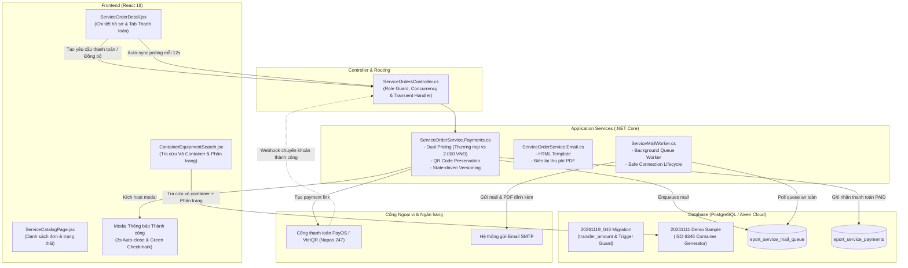

# Tài liệu Kỹ thuật & Vận hành: Hệ thống Đơn Dịch Vụ ePort, Cổng Thanh Toán VietQR (PayOS) & Quản lý Container Hãng Tàu

> **Phiên bản:** 2.0 (Cập nhật 11/2026)  
> **Phạm vi tài liệu:** Chi tiết kiến trúc, cơ chế hoạt động, luồng xử lý và tương tác giữa 11 tệp tin lõi thuộc Backend (.NET 8), Database (PostgreSQL/Aiven) và Frontend (React 18/Vite).

---

## Mục lục

1. [Tổng quan Kiến trúc Hệ thống](#1-tổng-quan-kiến-trúc-hệ-thống)
2. [Lớp Cơ sở dữ liệu (Database Layer)](#2-lớp-cơ-sở-dữ-liệu-database-layer)
   - [2.1 Migration 20261119_043 (`transfer_amount` & Ràng buộc bất biến)](#21-migration-20261119_043-transfer_amount--ràng-buộc-bất-biến)
   - [2.2 Mẫu dữ liệu Khai báo Container & Thuật toán ISO 6346 Modulo-11](#22-mẫu-dữ-liệu-khai-báo-container--thuật-toán-iso-6346-modulo-11)
3. [Lớp Dịch vụ Backend (.NET 8 C# Core)](#3-lớp-dịch-vụ-backend-net-8-c-core)
   - [3.1 `ServiceOrdersController.cs` - REST API & Xử lý Ngoại lệ](#31-serviceorderscontrollercs---rest-api--xử-lý-ngoại-lệ)
   - [3.2 `ServiceOrderService.Payments.cs` - Cơ chế Thanh toán & Dual-Pricing](#32-serviceorderservicepaymentscs---cơ-chế-thanh-toán--dual-pricing)
   - [3.3 `ServiceOrderService.Email.cs` - Mẫu Email & Phát hành Biên lai PDF](#33-serviceorderserviceemailcs---mẫu-email--phát-hành-biên-lai-pdf)
   - [3.4 `ServiceMailWorker.cs` - Background Service & Quản lý Connection Pool](#34-servicemailworkercs---background-service--quản-lý-connection-pool)
4. [Lớp Giao diện Người dùng (Frontend React 18)](#4-lớp-giao-diện-người-dùng-frontend-react-18)
   - [4.1 `serviceOrdersApi.js` - Tích hợp API Client](#41-serviceordersapijs---tích-hợp-api-client)
   - [4.2 `ServiceCatalogPage.jsx` - Trang Quản lý & Danh mục Dịch vụ](#42-servicecatalogpagejsx---trang-quản-lý--danh-mục-dịch-vụ)
   - [4.3 `ServiceOrderDetail.jsx` - Modal Chi tiết Đơn & Xử lý Giao dịch](#43-serviceorderdetailjsx---modal-chi-tiết-đơn--xử-lý-giao-dịch)
   - [4.4 `serviceOrders.css` - Giao diện & Hiệu ứng Chúc mừng Thành công](#44-serviceorderscss---giao-diện--hiệu-ứng-chúc-mừng-thành-công)
   - [4.5 `ContainerEquipmentSearch.jsx` - Tra cứu Vỏ Container & Phân trang](#45-containerequipmentsearchjsx---tra-cứu-vỏ-container--phân-trang)
5. [Quy trình Vận hành, Kiểm thử Live & Khắc phục Sự cố](#5-quy-trình-vận-hành-kiểm-thử-live--khắc-phục-sự-cố)

---

## 1. Tổng quan Kiến trúc Hệ thống

Luồng xử lý đơn dịch vụ (ePort Service Catalog) và thanh toán trực tuyến PayOS:



---

## 2. Lớp Cơ sở dữ liệu (Database Layer)

### 2.1 Migration 20261119_043 (`transfer_amount` & Ràng buộc bất biến)
* **Đường dẫn tệp:** [`database/migrations/20261119_043_eport_payos_transfer_amount.sql`](file:///d:/NexusPort/NexusPort-Backend-Website/database/migrations/20261119_043_eport_payos_transfer_amount.sql)
* **Mục tiêu cốt lõi:**
  1. Thêm cột `transfer_amount numeric(24,0)` vào bảng `eport_service_payments` để tách biệt **Số tiền thương mại thực tế của đơn hàng** (`amount`) và **Số tiền thực chuyển qua VietQR** (`transfer_amount`).
  2. Ràng buộc kiểm tra toàn vẹn dữ liệu: `CHECK (transfer_amount IS NULL OR transfer_amount > 0 AND transfer_amount <= 9007199254740991)`.
  3. Trigger bảo vệ bất biến `guard_eport_service_payment_identity()`:
     - **Chặn DELETE:** Tuyệt đối không cho xóa lịch sử thanh toán (`ERRCODE='23514'`).
     - **Chặn UPDATE thuộc tính định danh:** Cấm chỉnh sửa `(id, draft_id, request_id, number, method, order_code, amount, currency, created_by, created_at)`.
     - **Chặn sửa `transfer_amount`:** Ngoại trừ trường hợp khởi tạo ban đầu khi đơn ở trạng thái `PENDING`.
     - **Chặn cập nhật giao dịch đã đóng:** Khi trạng thái thanh toán đã là `SUCCEEDED`, `FAILED`, hoặc `CANCELLED`, dữ liệu trở thành bất biến tuyệt đối.
     - **Bảo toàn liên kết PayOS:** `payment_link_id` một khi đã cấp phát thì không được phép thay đổi.
     - **Khớp số tiền hóa đơn Dispatcher:** Yêu cầu thanh toán phải khớp với hóa đơn dịch vụ đã được phê duyệt (`eport_service_bills` hoặc `eport_service_registrations`).

### 2.2 Mẫu dữ liệu Khai báo Container & Thuật toán ISO 6346 Modulo-11
* **Đường dẫn tệp:** [`database/samples/20261111_eport_import_demo.sql`](file:///d:/NexusPort/NexusPort-Backend-Website/database/samples/20261111_eport_import_demo.sql)
* **Mục tiêu cốt lõi:**
  - Khởi tạo dữ liệu mẫu cho quy trình nhập khẩu ePort với các loại container khô (Dry: 20GP, 40GP), container lạnh (Reefer: 20RF, 40RH), container bồn (Tank) và container Flat Rack.
  - Sử dụng khóa cố vấn giao dịch `pg_advisory_xact_lock(hashtext('nexusport-demo-import-20261111'))` chống xung đột chèn dữ liệu đồng thời.
  - Tích hợp hàm tạo số container chuẩn quốc tế ISO 6346 `pg_temp.import_demo_number(serial)`:
    - 4 ký tự tiền tố BIC (Owner Code `DEM` + Category Identifier `U`).
    - 6 chữ số định danh duy nhất (Serial Number).
    - 1 chữ số kiểm tra (Check Digit) tính toán theo thuật toán trọng số lũy thừa của 2 và chia lấy dư modulo 11:
      $$\text{Total} = \sum_{i=1}^{10} \text{Value}_i \times 2^{i-1}$$
      $$\text{CheckDigit} = (\text{Total} \pmod{11}) \pmod{10}$$
  - Đảm bảo các hãng tàu đối tác (như Hapag-Lloyd `ship-hapag`, Maersk, CMA CGM) luôn có sẵn dữ liệu container hợp lệ về mặt kỹ thuật, trọng tải (`tare_weight_kg`, `max_gross_mass_kg`), và thông số lạnh (`required_power_kw`).

---

## 3. Lớp Dịch vụ Backend (.NET 8 C# Core)

### 3.1 `ServiceOrdersController.cs` - REST API & Xử lý Ngoại lệ
* **Đường dẫn tệp:** [`csharp-core/src/Modules/ServiceCatalog/Presentation/ServiceOrdersController.cs`](file:///d:/NexusPort/NexusPort-Backend-Website/csharp-core/src/Modules/ServiceCatalog/Presentation/ServiceOrdersController.cs)
* **Định tuyến:** `api/v1/ServiceOrders`
* **Kiểm soát quyền truy cập (RBAC):**
  - Cho phép các vai trò: `Transport Company`, `Carrier`, `Carrier Staff`, `Administrator`, `Admin`, `Dispatcher`.
  - Endpoint `payments/payos/webhook` và `resend-receipt` được gắn `[AllowAnonymous]` để cổng thanh toán PayOS gửi webhook tự động và người dùng ngoài có thể kích hoạt gửi lại biên lai.
* **Xử lý Ngoại lệ Tối ưu (Fault-tolerant Exception Handling):**
  - **`AppException`:** Trả về đúng HTTP Status Code do tầng nghiệp vụ định nghĩa (400, 404, 422).
  - **Lỗi schema PostgreSQL (`42P01`, `42703`):** Trả về HTTP 503 (`SERVICE_ORDER_SCHEMA_REQUIRED`).
  - **Xung đột Concurrency (`23505`, `23503`, `23514`, `40001`, `40P01`):** Trả về HTTP 409 (`SERVICE_ORDER_CONFLICT`), thông báo cho người dùng dữ liệu đã được cập nhật hoặc yêu cầu thao tác lại.
  - **Lỗi gián đoạn kết nối tạm thời (`NpgsqlException` / "transient failure"):** Bắt lỗi khi hồ bơi kết nối Aiven Cloud bị nghẽn và trả về HTTP 503 (`DATABASE_TRANSIENT_RETRY`), ngăn chặn việc ứng dụng quăng HTTP 500 unhandled.
* **Các Endpoint Chính:**
  | Phương thức | Tuyến đường | Mô tả |
  | --- | --- | --- |
  | `GET` | `/` | Lấy danh sách đơn theo trang, tìm kiếm, lọc trạng thái |
  | `GET` | `/{id}` | Lấy chi tiết đơn dịch vụ, bảng phí, container, timeline |
  | `GET` | `/{id}/payments` | Lấy danh sách giao dịch thanh toán của đơn |
  | `POST` | `/{id}/payments` | Tạo yêu cầu thanh toán VietQR / PayOS |
  | `POST` | `/{id}/payments/{paymentId}/sync` | Đồng bộ thủ công hoặc tự động trạng thái từ VietQR |
  | `POST` | `/{id}/payments/{paymentId}/cancel` | Hủy yêu cầu thanh toán đang chờ |
  | `POST` | `/payments/payos/webhook` | Tiếp nhận Webhook có chữ ký HMAC SHA256 từ PayOS |
  | `POST` | `/{id}/resend-receipt` | Gửi lại email biên lai thu phí kèm PDF |

### 3.2 `ServiceOrderService.Payments.cs` - Cơ chế Thanh toán & Dual-Pricing
* **Đường dẫn tệp:** [`csharp-core/src/Modules/ServiceCatalog/Application/ServiceOrderService.Payments.cs`](file:///d:/NexusPort/NexusPort-Backend-Website/csharp-core/src/Modules/ServiceCatalog/Application/ServiceOrderService.Payments.cs)
* **Cơ chế Dual-Pricing (Giá Thương mại vs Phí Test Thực tế):**
  - Trong môi trường Development, khi thiết lập biến môi trường `NEXUSPORT_EPORT_PAYOS_AMOUNT=2000`, hệ thống sẽ:
    1. Lưu giữ nguyên vẹn tổng giá trị thương mại do Dispatcher duyệt (`order.total`, ví dụ: 583.200 đ hoặc 669.600 đ) vào cột `amount` của bảng `eport_service_payments` và hồ sơ hóa đơn.
    2. Gửi sang cổng PayOS số tiền chuyển khoản thực tế là **2.000 VNĐ** (lưu tại cột `transfer_amount`).
    3. Mã QR và tài khoản ngân hàng thụ hưởng MBBank sẽ nhận đúng 2.000 VNĐ, người kiểm thử có thể quét mã trực tiếp bằng ứng dụng ngân hàng mà không cần chi trả toàn bộ phí cảng.
* **Bảo toàn Chuỗi Mã QR VietQR (`NULLIF` SQL Logic):**
  - Khi gọi PayOS `GetAsync` để đồng bộ (`sync`), PayOS không trả lại chuỗi `qrCode` đã tạo ban đầu.
  - Khắc phục lỗi làm trắng mã QR bằng câu lệnh SQL an toàn:
    ```sql
    qr_code = COALESCE(NULLIF(@p5, ''), qr_code)
    ```
    Giúp bảo toàn mã QR VietQR hiện tại khi phản hồi sync rỗng.
* **Quản lý Phiên bản Lạc quan (State-driven Concurrency Versioning):**
  - Chỉ tăng `version` của đơn dịch vụ khi thực sự có sự thay đổi trạng thái thanh toán (`targetPaymentStatus != S(order, "paymentStatus")`).
  - Trong các lượt kiểm tra nền định kỳ (`SYNC`), nới lỏng kiểm tra `expectedVersion` để tránh tình trạng Frontend bị lệch version và báo lỗi 409 giả tạo.
* **Idempotency Fingerprint:**
  - Áp dụng băm SHA256 cho chuỗi `action + paymentId + actor + payload` để đảm bảo thao tác gửi trùng lặp sẽ tái hiện kết quả cũ mà không tạo thêm giao dịch rác.

### 3.3 `ServiceOrderService.Email.cs` - Mẫu Email & Phát hành Biên lai PDF
* **Đường dẫn tệp:** [`csharp-core/src/Modules/ServiceCatalog/Application/ServiceOrderService.Email.cs`](file:///d:/NexusPort/NexusPort-Backend-Website/csharp-core/src/Modules/ServiceCatalog/Application/ServiceOrderService.Email.cs)
* **Nhiệm vụ:**
  - Tạo email HTML chuyên nghiệp theo chuẩn giao diện NexusPort cho hai sự kiện:
    1. **Thông báo phê duyệt phí dịch vụ cảng (`PAYMENT_NOTICE`):** Báo cho doanh nghiệp đăng ký biết đơn đã được Dispatcher định phí kèm bảng kê chi tiết từng container.
    2. **Biên lai thu phí & Xác nhận hoàn tất dịch vụ (`PAYMENT_RECEIPT`):** Tự động gửi ngay sau khi giao dịch chuyển khoản VietQR được đối chiếu thành công (`PAID`).
  - Tạo tài liệu biên lai PDF chứa:
    - Mã đơn hàng (VD: `DV-25E1B3774C954B558D7AD3E9EDB2CB38`)
    - Mã đối chiếu ngân hàng (`bank_reference`, mã chuẩn `DVxxxxxxx`)
    - Số tiền đã thanh toán (định dạng `N0` tiếng Việt)
    - Con dấu xác nhận điện tử của Cảng NexusPort.

### 3.4 `ServiceMailWorker.cs` - Background Service & Quản lý Connection Pool
* **Đường dẫn tệp:** [`csharp-core/src/Modules/ServiceCatalog/Application/ServiceMailWorker.cs`](file:///d:/NexusPort/NexusPort-Backend-Website/csharp-core/src/Modules/ServiceCatalog/Application/ServiceMailWorker.cs)
* **Cơ chế Hàng đợi Email & Xử lý An toàn Connection:**
  - Kế thừa `BackgroundService`, chạy ngầm kiểm tra bảng `eport_service_mail_queue` với chu kỳ nghỉ (idle interval) **10 giây**.
  - **Cơ chế Khóa Hàng Đợi (Lease Locking):**
    - Sử dụng `FOR UPDATE SKIP LOCKED LIMIT 1` và gán `lease_id = Guid.NewGuid()` trong thời hạn 2 phút để tránh việc các tiến trình xử lý trùng email.
  - **Quản lý Vòng đời Kết nối Cơ sở Dữ liệu:**
    - Sử dụng khối `try ... finally` bắt buộc kiểm tra và đóng kết nối nếu mở thủ công:
      ```csharp
      finally
      {
          if (wasClosed && connection.State == System.Data.ConnectionState.Open)
          {
              await db.Database.CloseConnectionAsync();
          }
      }
      ```
    - Ngăn chặn hoàn toàn hiện tượng rò rỉ kết nối (Connection Leak) trên PostgreSQL Aiven Cloud (vốn giới hạn ~20 kết nối cho gói tiêu chuẩn).

---

## 4. Lớp Giao diện Người dùng (Frontend React 18)

### 4.1 `serviceOrdersApi.js` - Tích hợp API Client
* **Đường dẫn tệp:** [`NexusPort_FRONTEND_Website/src/features/service-catalog/serviceOrdersApi.js`](file:///d:/NexusPort/NexusPort_FRONTEND_Website/src/features/service-catalog/serviceOrdersApi.js)
* **Các phương thức:**
  - `serviceOrdersApi.list(params)`: Lấy danh sách phân trang các đơn dịch vụ.
  - `serviceOrdersApi.get(id)`: Lấy thông tin chi tiết một đơn.
  - `serviceOrdersApi.payments(id)`: Lấy các giao dịch thanh toán kèm mã VietQR.
  - `serviceOrdersApi.createPayment(id, body)`: Khởi tạo yêu cầu VietQR PayOS.
  - `serviceOrdersApi.syncPayment(id, paymentId, body)`: Yêu cầu backend gọi PayOS kiểm tra đối soát tài khoản MBBank.
  - `serviceOrdersApi.cancelPayment(id, paymentId, body)`: Hủy mã thanh toán đang mở.
  - `serviceOrdersApi.receipt(id, sourceContainerId)`: Lấy dữ liệu chứng từ / biên lai thanh toán.
* **Từ điển Trạng thái & Màu sắc (Tones):**
  - Chuyển đổi mã trạng thái (`DRAFT`, `CONFIRMED`, `APPROVED`, `PAID`, `PENDING`, `SUBMITTED`, `FAILED`) sang nhãn tiếng Việt và tone màu trực quan (green, blue, orange, red, yellow).

### 4.2 `ServiceCatalogPage.jsx` - Trang Quản lý & Danh mục Dịch vụ
* **Đường dẫn tệp:** [`NexusPort_FRONTEND_Website/src/features/service-catalog/ServiceCatalogPage.jsx`](file:///d:/NexusPort/NexusPort_FRONTEND_Website/src/features/service-catalog/ServiceCatalogPage.jsx)
* **Chức năng:**
  - Hai tab chuyển đổi: **Dịch vụ cảng** (Đăng ký mới dịch vụ lấy container, hạ bãi, rút ruột, v.v.) và **Đơn dịch vụ** (Theo dõi tiến độ xử lý hồ sơ).
  - Tích hợp bộ lọc đa chiều: Từ khóa tìm kiếm, Trạng thái hồ sơ (`Tất cả`, `Chờ duyệt`, `Đã duyệt`, `Đã đóng`), Trạng thái thanh toán (`Chờ thanh toán`, `Đã thanh toán`).
  - Quản lý phân trang Server-side (hỗ trợ các kích cỡ trang 10, 20, 50).
  - Điều hướng URL Param: Nhấp vào một đơn hàng sẽ mở Drawer/Modal chi tiết thông qua query parameter `?order={id}`.

### 4.3 `ServiceOrderDetail.jsx` - Modal Chi tiết Đơn & Xử lý Giao dịch
* **Đường dẫn tệp:** [`NexusPort_FRONTEND_Website/src/features/service-catalog/ServiceOrderDetail.jsx`](file:///d:/NexusPort/NexusPort_FRONTEND_Website/src/features/service-catalog/ServiceOrderDetail.jsx)
* **Các Tab Chức năng:**
  1. **Thông tin:** Hiển thị thông tin tổng thể, loại dịch vụ, danh sách container, biểu phí đã duyệt.
  2. **Thanh toán:**
     - Nút "Tạo mã thanh toán VietQR".
     - Khi tạo xong, hiển thị Thẻ VietQR động với mã QR Napas247, Ngân hàng Quân Đội (MBBank), Số tài khoản, Tên chủ tài khoản, Số tiền (hiển thị tách biệt số tiền thương mại và số tiền chuyển khoản thực tế), cùng cú pháp chuyển khoản `DVxxxxxxx`.
     - Nút "Sao chép số tài khoản", "Sao chép nội dung", "Kiểm tra thanh toán".
  3. **Hóa đơn:** Bảng kê chi tiết từng dòng dịch vụ kèm thuế suất VAT.
  4. **Lịch sử:** Dòng thời gian ghi nhận các bước: Đăng ký -> Dispatcher tiếp nhận -> Phê duyệt -> Tạo thanh toán -> Khách thanh toán -> Gửi email biên lai.
* **Tự động Kiểm tra Đối soát (Background Auto-sync):**
  - Khi tab "Thanh toán" đang mở và có yêu cầu ở trạng thái `PENDING`, hook `useEffect` kích hoạt chu kỳ gọi `syncPayment` mỗi **12 giây**.
  - Tách biệt khỏi trạng thái `mutation` để lỗi kết nối tạm thời không làm chớp nháy bảng lỗi trên màn hình người dùng.
* **Thông báo Thành công (3-second Green Checkmark Modal):**
  - Ngay khi nhận được phản hồi thanh toán thành công (`paymentStatus === 'PAID'`), modal `PaymentSuccessDialog` được kích hoạt ở chính giữa màn hình với biểu tượng dấu tích xanh động, tự động đóng sau 3 giây hoặc người dùng có thể nhấp đóng ngay.

### 4.4 `serviceOrders.css` - Giao diện & Hiệu ứng Chúc mừng Thành công
* **Đường dẫn tệp:** [`NexusPort_FRONTEND_Website/src/features/service-catalog/serviceOrders.css`](file:///d:/NexusPort/NexusPort_FRONTEND_Website/src/features/service-catalog/serviceOrders.css)
* **Quy chuẩn Thiết kế:**
  - Bố cục responsive dạng Drawer/Modal tràn viền bo góc `rounded-2xl`.
  - Phân vùng màu sắc sắc nét: Thanh trạng thái màu cam/xanh lá, thẻ VietQR nền trắng viền xám nhạt với độ bóng mềm mại.
  - Hiệu ứng dấu tích xanh thành công (`.success-checkmark-circle`, `.payment-success-modal`):
    - Đặt vị trí chính giữa màn hình với lớp phủ mờ (backdrop).
    - Vòng tròn màu xanh lá (`#22c55e`) kèm hoạt họa phóng to nhẹ (`scale-in`) và dấu tích trắng nổi bật.

### 4.5 `ContainerEquipmentSearch.jsx` - Tra cứu Vỏ Container & Phân trang
* **Đường dẫn tệp:** [`NexusPort_FRONTEND_Website/src/pages/Containers/ContainerEquipmentSearch.jsx`](file:///d:/NexusPort/NexusPort_FRONTEND_Website/src/pages/Containers/ContainerEquipmentSearch.jsx)
* **Tính năng:**
  - Hỗ trợ hãng tàu (ví dụ: `ship-hapag` - Hapag-Lloyd AG) tra cứu kho vỏ container đã đăng ký tại cảng.
  - Bộ lọc: Số container, Tiền tố BIC (ví dụ `HAMU`, `HLXU`, `HLBU`), Loại container trong danh mục, Mã ISO kích cỡ/loại (ví dụ `45G0`, `22G1`, `45R1`).
  - **Tích hợp Phân trang Đầy đủ (`ShippingPagination`):**
    - Tùy chọn số lượng bản ghi trên một trang: `[5, 10, 15, 20]` (mặc định 5).
    - Các nút điều hướng nhanh: Trang đầu (`first_page`), Trang trước (`chevron_left`), Danh sách số trang `[1] [2] [3]...`, Trang sau (`chevron_right`), Trang cuối (`last_page`).
    - Dòng thông tin tổng kết: "Hiển thị 1 - 5 trong tổng số 15 container".

---

## 5. Quy trình Vận hành, Kiểm thử Live & Khắc phục Sự cố

### 5.1 Quy trình Kiểm thử Thanh toán VietQR Live 2.000 VNĐ
1. **Khởi động Backend:**
   - Đảm bảo các biến môi trường cấu hình cổng thanh toán được nạp trong phiên chạy:
     ```powershell
     $env:ASPNETCORE_ENVIRONMENT="Development"
     $env:NEXUSPORT_EPORT_PAYOS_AMOUNT="2000"
     cd D:\NexusPort\NexusPort-Backend-Website\csharp-core\src\NexusPort.Api
     dotnet run
     ```
2. **Thực hiện Luồng Trên Giao diện:**
   - Đăng nhập tài khoản công ty vận tải (ví dụ `carrier01` hoặc `dauboquay`).
   - Vào mục **Hồ sơ dịch vụ** -> Mở một đơn đã được duyệt (ví dụ đơn `1000000044`).
   - Mở tab **Thanh toán** -> Nhấp **Tạo mã thanh toán VietQR**.
   - Thẻ VietQR xuất hiện với số tiền chuyển khoản là **2.000 đ** và nội dung chuyển khoản là `DV0000044`.
3. **Quét Mã & Đối Soát:**
   - Dùng ứng dụng ngân hàng bất kỳ quét mã VietQR và xác nhận chuyển 2.000 VNĐ.
   - Trong vòng 10-12 giây, hệ thống tự động đồng bộ trạng thái giao dịch với VietQR.
   - Khi tiền về thành công:
     - Màn hình hiển thị modal dấu tích xanh thành công trong 3 giây.
     - Trạng thái đơn chuyển sang `Đã thanh toán (PAID)`.
     - Nút "In biên lai / Tải PDF" xuất hiện để tải chứng từ thu tiền.
     - Hàng đợi ngầm tự động gửi email thông báo kèm biên lai PDF về hòm thư người đăng ký.

### 5.2 Xử lý Sự cố Thường gặp

| Triệu chứng | Nguyên nhân | Cách khắc phục |
| --- | --- | --- |
| **HTTP 409 Conflict** khi tạo thanh toán | Phiên bản `version` của đơn hàng bị lệch giữa client và DB do thao tác liên tục. | Nhấp nút **"Tải lại hồ sơ"** trên thanh thông báo để đồng bộ lại `version` mới nhất rồi tiếp tục. |
| **HTTP 503 / "transient failure"** | Cơ sở dữ liệu Aiven Cloud bị nghẽn số lượng kết nối tối đa. | Không sửa file cấu hình. Kiểm tra các tiến trình build ngầm bằng lệnh `dotnet build-server shutdown` và để `ServiceMailWorker` tự đóng connection qua `try...finally`. |
| **Mã QR bị trắng khi bấm Kiểm tra** | API sync của PayOS không trả lại chuỗi `qrCode`. | Đã được xử lý triệt để tại Backend bằng câu lệnh `qr_code = COALESCE(NULLIF(@p5, ''), qr_code)`. |
| **Port 5000: Address in use** | Phiên bản `dotnet run` trước đó chưa tắt hẳn. | Dùng PowerShell chạy `Get-Process NexusPort.Api \| Stop-Process` hoặc `dotnet build-server shutdown` rồi chạy lại. |
