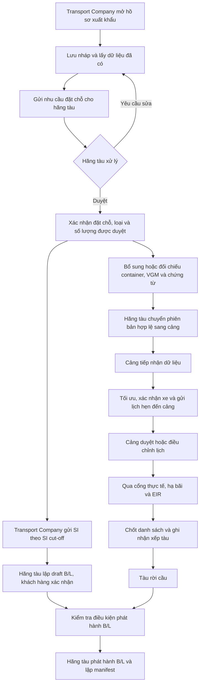

# Kế hoạch tối ưu Booking xuất khẩu của Transport Company

Ngày đối chiếu: **05/11/2026**. Đây là **đề xuất phát triển**, phân biệt với chức năng đã có trong code. Tài liệu này không triển khai thay đổi ứng dụng hoặc database.

**1. Mục tiêu và phạm vi**

Transport Company bắt đầu luồng, trong vai trò chủ hàng hoặc đại diện được phép khai hồ sơ. Người dùng chọn nhu cầu và dữ liệu có sẵn; hệ thống điền lại thông tin, kiểm tra điều kiện và đề xuất phương án. Người dùng tập trung xử lý những trường còn thiếu hoặc mâu thuẫn.

Giữ một hồ sơ xuất khẩu xuyên suốt: **đặt chỗ hãng tàu → danh sách container → lịch xe cảng → SI/draft B/L → theo dõi thực hiện**. Một giao diện thống nhất không có nghĩa mọi thông tin phải nhập đủ hoặc mọi bên phải duyệt cùng lúc.

Phần triển khai chính thuộc **Booking C# và giao diện Transport Company**. Thay đổi giao diện hãng tàu, điều phối, cổng, bãi hoặc danh mục xe/tài xế phải được tách thành nhiệm vụ cho nhóm phụ trách, dựa trên hợp đồng API đã thống nhất.

Tài liệu nghiệp vụ gốc mô tả mô hình FCL chung, bắt đầu ở bước 7 sau khi duyệt đặt chỗ. Các mốc thời gian giả định trong tài liệu không trở thành giá trị cố định trong chương trình; thời hạn phải lấy từ lịch chuyến đã công bố. Kế hoạch không khẳng định đã xác thực quy trình riêng của cảng Tiên Sa hay từng hãng tàu.

**2. Những gì đang có và những điểm cần tối ưu**

| Nội dung | Code hiện tại | Hướng phát triển |
| --- | --- | --- |
| Hồ sơ khách hàng | C# lưu hồ sơ gửi hãng tàu, container, chứng từ và lịch xe đề xuất | Giữ và mở rộng thành hồ sơ có thể lưu nháp, bổ sung theo mốc |
| Gửi trước khi biết số container | Có API đặt chỗ kiểu cũ; form hợp nhất hiện yêu cầu container cụ thể, VGM và phân công xe khi gửi | Hỗ trợ cả chưa có container và đã có container trong cùng một hồ sơ |
| Hãng tàu tiếp nhận | C# có API duyệt/từ chối; giao diện hãng tàu gọi `/api/shipping`, còn trộn dữ liệu mẫu và có thao tác trong bộ nhớ | Thống nhất nguồn C# hoặc adapter thực sự đọc/ghi cùng dữ liệu; bỏ thành công giả trong luồng tích hợp |
| Duyệt và phân công xe | Khi hãng tàu duyệt hồ sơ hợp nhất, backend kiểm tra lại và có thể đổi xe/tài xế; thiếu phương tiện có thể chặn duyệt | Tách quyết định đặt chỗ khỏi việc phân công vận tải; thay đổi quan trọng cần Transport Company xác nhận |
| Lịch rảnh | Đã xét lịch trùng, ưu tiên tài xế phụ trách xe; bộ tìm giờ còn dịch từng giờ với số lần thử cố định | Tìm theo giao của lịch tài nguyên, cửa sổ nhận hàng và năng lực cảng khi có dữ liệu |
| Rơ-moóc | Gợi ý từ biển số đã sử dụng trong lịch sử | Dùng lịch sử làm gợi ý; nguồn xác định khả dụng cần danh mục và lịch moóc có thật |
| Chứng từ | Tải S3, lưu tham chiếu trong hồ sơ; phạm vi chung dựa vào khai báo/xác nhận | Lưu metadata bền vững, đọc tệp và đối chiếu phạm vi; không coi tải tệp là đã xác minh |
| AI | Service hiện có chủ yếu nhận diện phương tiện/biển số ở cổng | OCR chứng từ là chức năng mới cần endpoint và kiểm thử riêng |
| Trạng thái cảng | `portStatus=Accepted` đang biểu diễn tiếp nhận dữ liệu; lịch xe tạo ra vẫn Pending | Giao diện phân biệt rõ đã nhận dữ liệu với đã duyệt lịch xe |
| B/L và ngoại lệ | Một B/L cuối cùng mỗi Booking; chuyển một phần lô/tách nhiều B/L chưa hoàn chỉnh | Giữ giới hạn MVP rõ ràng; thiết kế ngoại lệ riêng ở giai đoạn sau |

**3. Luồng xuất khẩu đề xuất**

Có thể chuẩn bị container, tài liệu và phương án xe sớm ngay từ bản nháp. Những phần đã có được chuyển tiếp, không yêu cầu nhập hoặc tải lại. Chỉ phần được duyệt và đủ điều kiện mới trở thành dữ liệu chính thức cho bước tiếp theo.

| Mốc | Transport Company thực hiện | Hệ thống tự động | Điều kiện hoàn thành |
| --- | --- | --- | --- |
| Khởi tạo | Chọn nhu cầu, tuyến/chuyến hoặc hồ sơ có sẵn | Lấy công ty đăng nhập, tham chiếu chuyến, nguồn hàng; lưu nháp | Có mã hồ sơ nháp; chưa giữ xe hoặc vị trí bãi |
| Xin đặt chỗ | Xác nhận nhu cầu loại/số lượng container và hãng tàu | Nếu đã chọn container thì tính số lượng theo từng loại; kiểm tra chuyến còn mở | Hãng tàu nhận yêu cầu thật; chưa bắt buộc đủ xe, VGM hoặc số container chưa biết |
| Khai danh sách | Chọn/bổ sung container, xác nhận dữ liệu trích xuất | Điền seal, loại, hàng, khối lượng khai báo; đối chiếu VGM, chứng từ và số lượng được duyệt | Đúng hạn VGM, đúng nguồn riêng của công ty, không trùng hồ sơ hiệu lực |
| Gửi cảng | Theo dõi kết quả từ hãng tàu | Gửi phiên bản và theo dõi biên nhận | Cảng nhận đúng danh sách; biên nhận chưa phải duyệt lịch xe |
| Bố trí vận tải | Xác nhận phương án đề xuất hoặc chọn phương án khác | Chọn xe, tài xế, moóc và giờ khả thi; kiểm tra lại khi xác nhận | Lịch xe được lưu, được cảng xử lý đúng trạng thái; không dùng phương tiện bận |
| Giao hàng | Tài xế thực hiện lịch đã được chấp nhận | Theo dõi sự kiện thật, thông báo thiếu điều kiện | Gate In/EIR/hạ bãi do bộ phận cảng ghi nhận; không sinh từ nút tạo Booking |
| SI và B/L | Kiểm tra SI đã điền sẵn, xác nhận đúng draft | Lấy thông tin có nguồn, cảnh báo hạn và thay đổi danh sách | SI và draft đúng phiên bản; hãng tàu phát hành B/L khi đủ điều kiện |

**Hai cách bắt đầu dùng chung giao diện:**

- **Đã có container:** chọn container, hệ thống dựng yêu cầu đặt chỗ và điền hồ sơ; cho phép chuẩn bị trước các thông tin sẵn có.
- **Chưa có container:** khai nhu cầu loại/số lượng, gửi xin đặt chỗ; bổ sung số container sau khi có vỏ và đóng hàng. Không tạo container giả để vượt bước này.

SI có lịch riêng và có thể làm song song với vận chuyển. Không bắt khách hàng đợi container vào cổng mới được nộp SI.

**4. Dữ liệu tự điền và nguồn tin cậy**

| Thông tin | Nguồn ưu tiên | Cách xử lý tự động |
| --- | --- | --- |
| Công ty đặt hồ sơ | Membership tài khoản trong database | Server xác định; không nhận công ty do client tự khai |
| Container, loại, seal, hàng, khối lượng khai báo | Bản khai riêng của công ty | Điền theo bản khai đã chọn, giữ ID nguồn; không lấy cargo từ master vật lý dùng chung |
| Hãng tàu, chuyến và cảng đến | Lịch chuyến/Booking Note hợp lệ | Dropdown dữ liệu thật; điền tuyến và cut-off sau khi chọn chuyến; không suy hãng tàu chỉ từ tiền tố số container |
| Số lượng | Container đã chọn hoặc nhu cầu đặt chỗ đã xác nhận | Đếm container khác nhau; tách số lượng yêu cầu, được duyệt, đã khai và còn cần khai |
| VGM | Kết quả cân/phiếu VGM gắn đúng container | Trích xuất, chuẩn hóa đơn vị khi biết rõ, yêu cầu xác nhận; không thay bằng khối lượng hàng |
| Nhiệt độ, UN, phân lớp nguy hiểm | Chỉ dẫn bảo quản/hồ sơ hàng đặc biệt | Điền từ nguồn phù hợp và đánh dấu nơi thiếu hoặc mâu thuẫn |
| Shipper, consignee, notify party | Hồ sơ khách hàng được phép sử dụng, SI đã xác nhận, chứng từ tương ứng | Gợi ý có nguồn và cho kiểm tra; không mặc định công ty đầu kéo là shipper |
| Số kiện, khối lượng hàng của SI | Packing List hoặc dữ liệu hàng đã xác nhận | Tổng hợp đúng một lần theo phạm vi container; không lấy tổng VGM làm khối lượng hàng |
| Xe/tài xế/moóc | Đội xe công ty, phân công và lịch hoạt động thật | Chỉ đề xuất tổ hợp hợp lệ, đang rảnh theo lịch; thiếu nguồn moóc thì báo cần bổ sung |

Mỗi thông tin tự điền quan trọng cần biết nguồn, phiên bản và thời điểm lấy. Khi đổi chuyến hoặc đổi danh sách, chỉ tính lại phần liên quan, không xóa các chứng từ và thông tin người dùng đã xác nhận còn phù hợp.

**5. Tối ưu xe, tài xế, moóc và khung giờ**

Đầu vào của bộ tối ưu gồm cửa sổ mở nhận–CY cut-off, danh sách container, lịch xe/tài xế/moóc, thời gian phục vụ và di chuyển cần thiết, cùng năng lực tiếp nhận cảng nếu có nguồn chính thức.

Trình tự xử lý đề xuất:

1. Loại tổ hợp không hợp lệ: khác công ty, trạng thái không phù hợp, hồ sơ bắt buộc không đạt, lịch trùng hoặc chuyến đang thực hiện chưa kết thúc.
2. Tìm các khoảng rảnh giao nhau của xe, tài xế và moóc; giữ đủ thời gian làm việc và quay vòng. Trạng thái tài xế “đã nhận xe” phải được hiểu cùng lịch thực hiện, không tự coi là một chuyến đang bận.
3. Giao với cửa sổ nhận hàng và sức chứa theo giờ do cảng công bố. Nhiều xe được cùng một khung giờ nếu còn năng lực phục vụ và dùng các bộ tài nguyên khác nhau.
4. Xếp hạng theo khả năng kịp cut-off, thời gian chờ, cặp xe–tài xế phụ trách và mức thay đổi so với lựa chọn đã xác nhận.
5. Đề xuất phương án tốt nhất và tối đa vài phương án thay thế, kèm lý do dễ hiểu. Nếu không có phương án, chỉ rõ thiếu xe, tài xế, moóc, khung cảng hay dữ liệu.
6. Với lô lớn, chia các đợt giao theo lịch rảnh. Tái sử dụng phương tiện ở các đợt không trùng chỉ khi có đủ thời gian quay vòng; không bắt mỗi container phải có một xe riêng suốt cả ngày.
7. Kiểm tra lại và khóa lịch theo giao dịch khi người dùng xác nhận. Hai phiên cùng nhìn thấy một xe rảnh không được cùng đặt xe đó ở hai chuyến trùng nhau.

Lịch đề xuất trước khi duyệt đặt chỗ không giữ phương tiện vô thời hạn. Khi phương án hết hiệu lực, hệ thống tính lại và nêu phần thay đổi. Đổi ngày, xe, tài xế hoặc moóc so với phương án đã được Transport Company xác nhận phải có thông báo; chỉ tự áp dụng trong phạm vi khách hàng đã đồng ý trước.

Giữ yêu cầu hiện tại: không đưa lại điều kiện tải trọng phương tiện đã bỏ. Dữ liệu VGM và khối lượng container vẫn thuộc kiểm tra hồ sơ hàng. Nguồn danh mục moóc, năng lực cảng và thời gian phục vụ cần phối hợp nhóm sở hữu; không sinh biển moóc hoặc công suất tiếp nhận giả.

**6. Chứng từ S3 và giảm nhập tay bằng trích xuất**

Luồng đề xuất: **tải một lần lên S3 → ghi metadata → đọc tệp → đối chiếu → chỉ yêu cầu xử lý phần thiếu/sai → xác nhận phạm vi → dùng lại theo quyền**.

- Lưu khóa đối tượng S3 và metadata bền vững: tên gốc, loại tệp, kích thước, hash, người tải, thời điểm và phiên bản. Khi mở hồ sơ, C# kiểm tra quyền rồi cấp URL ký mới; không phụ thuộc duy nhất vào URL tạm được lưu từ lần upload trước.
- Ưu tiên đọc lớp text của PDF; OCR dành cho ảnh hoặc bản scan. Tích hợp đọc chứng từ là nhiệm vụ mới, không coi API nhận diện biển số tại cổng là đã hỗ trợ chứng từ.
- Trích xuất số container, seal, tham chiếu chứng từ, VGM/đơn vị, số kiện và các thông tin có mặt thực sự trên tệp. Không suy diễn giá trị không có nguồn.
- Tách ba phạm vi: container **khách hàng khai** được chứng từ bao phủ, container **máy đọc được**, và phạm vi **đã được người có trách nhiệm xác nhận**. Sao chép toàn bộ container đã chọn vào một trường không chứng minh chứng từ bao gồm cả lô.
- Nếu một chứng từ dùng chung thực sự bao phủ lô, tái sử dụng một tệp. Nếu chứng từ riêng, tự gắn đúng container. Không ép VGM riêng của một container thành VGM cho cả lô.
- Dữ liệu đọc được chỉ là đề xuất. Chứng từ thông quan và số chì quan sát tại cổng vẫn cần nguồn/sự xác nhận đúng thẩm quyền; tải file hoặc OCR không tự cấp quyền qua cổng.
- Công việc trích xuất chạy nền, có trạng thái và thử lại; AI/S3 lỗi phải hiển thị rõ, giữ bản nháp và phần đã nhập. Không hiển thị thành công giả hoặc chuyển file sang local khi yêu cầu lưu S3.

Chứng từ phụ thuộc **nghiệp vụ, loại hàng và mốc xử lý**. Trước khi hãng tàu duyệt không bắt nhập số Booking Note chính thức chưa được cấp; B/L xuất cuối cùng không phải đầu vào bắt buộc của yêu cầu đặt chỗ. Các loại chứng từ khác chỉ bắt buộc khi chính sách nghiệp vụ đã được chốt, không biến mọi chứng từ thương mại thành điều kiện cứng cho mọi bước.

**7. Booking theo lô và hai chiều**

Một lô xuất khẩu gồm **2–50 container khác nhau**, cùng công ty có quyền đặt, cùng nghiệp vụ Giao, cùng hãng tàu/chuyến trong hồ sơ, cùng loại hàng theo quy tắc hiện tại và bộ hồ sơ phù hợp. Nếu phát hành chung một B/L, dữ liệu SI/người gửi–người nhận cũng phải phù hợp với việc phát hành chung đó.

Không bắt buộc cùng kích thước hoặc cùng giờ hẹn. Tuy nhiên, số lượng theo từng loại phải nằm trong cơ cấu hãng tàu đã duyệt, không chỉ kiểm tra một tổng số với mã `MIXED`. Mỗi container có seal, VGM, bản khai, điều kiện bảo quản và chuyến xe riêng.

Dropdown có thể nhóm theo khả năng ghép, nhưng việc ghép không được chỉ dựa vào loại hàng hoặc tên khách hàng dạng chuỗi. Những container đã được giữ trong hồ sơ gửi có hiệu lực không xuất hiện như nguồn để đặt mới. Khi sửa chính hồ sơ đó, giữ các container hiện có để chỉnh sửa và ghi rõ ngữ cảnh.

Đếm tách biệt: **số hồ sơ hãng tàu**, **số container xuất**, **số chuyến xe** và **số tác nghiệp**. Với hai chiều, một container Giao và một container Nhận tạo một chuyến xe có hai tác nghiệp; số lượng đặt chỗ tàu chỉ tính container Giao. Hồ sơ Nhận và quyền lấy hàng vẫn riêng, không nhập chung chứng từ xuất.

**8. Trạng thái, bàn giao và ngoại lệ**

Không dùng một trạng thái để đại diện cả hãng tàu, lịch xe, chứng từ và vận hành. Giữ các trục độc lập và hiển thị trạng thái tổng hợp từ dữ liệu thật:

| Trục | Các mốc cần phân biệt |
| --- | --- |
| Hồ sơ khách hàng | Nháp, đã gửi, cần bổ sung, đã được hãng tàu duyệt, từ chối, hủy |
| Danh sách container | Chưa khai đủ, chờ kiểm tra, đã chuyển cảng, có phản hồi |
| Lịch xe | Chưa phân công, đang đề xuất, chờ cảng duyệt, được chấp nhận, cần điều chỉnh, hoàn tất/hủy |
| Container | Dự kiến, Gate In thực tế, hạ bãi, Loaded, bị loại/chuyển chuyến |
| SI/B/L | SI chưa nộp/đã nộp, draft đúng phiên bản, khách hàng xác nhận, B/L phát hành |
| Thông điệp | Đang chờ gửi, bên nhận đã tiếp nhận, lỗi cần thử lại hoặc xử lý |

Mỗi thay đổi có tác nhân, thời điểm, lý do và phiên bản. Trạng thái “cảng đã nhận dữ liệu” không được hiển thị như “cảng đã duyệt lịch”. Một container qua cổng không làm cả lô thành đã qua cổng; hiển thị số lượng hoàn thành/tổng số.

| Tình huống | Cách xử lý đề xuất |
| --- | --- |
| Hãng tàu yêu cầu sửa | Chỉ rõ dòng/trường/chứng từ cần sửa, giữ phần hợp lệ, ghi phiên bản khi gửi lại |
| Phương tiện bận sau khi gửi | Không làm mất quyết định đặt chỗ; chuyển lịch xe sang cần phân công/tối ưu lại, thông báo thay đổi cho khách hàng |
| Đổi container trước cut-off | Cho sửa phần chưa thực hiện, kiểm tra lại cơ cấu được duyệt và gửi phiên bản danh sách mới |
| Đã có container Gate In | Khóa dữ liệu lịch sử liên quan; không hủy toàn bộ hoặc viết lại dấu vết vật lý bằng thao tác sửa hồ sơ |
| Trễ VGM/SI/CY cut-off | Hiển thị đúng mốc bị vi phạm; ngoại lệ cần quyền, lý do, phạm vi và hạn hiệu lực; không tự bỏ điều kiện |
| Bị từ chối ở cổng | Giữ lý do và tác nghiệp thật, xử lý điều chỉnh/ngoại lệ đúng quyền; không tự sinh Gate In thành công |
| Một phần lô không lên tàu | Hãng tàu xử lý loại/chuyển chuyến với cảng; vô hiệu draft B/L bị ảnh hưởng, giữ liên kết container/lượt bãi đã có |
| Gửi/lưu lặp hoặc hai tab sửa cùng lúc | Idempotency cho lệnh, version cho sửa; trả xung đột và phần thay đổi, không âm thầm ghi đè |

Sự kiện sử dụng ID duy nhất và phiên bản, outbox/inbox và khả năng thử lại. Chỉ báo đã nhận khi bên nhận ghi nhận; thông điệp cũ hoặc trùng không được làm lùi trạng thái. Việc mở cổng, Gate In thật, EIR, hạ bãi và Gate Out của xe là các sự kiện riêng. Xe Giao ra cổng không có nghĩa container xuất đã rời bãi.

**9. Kế hoạch triển khai theo ưu tiên**

| Giai đoạn | Việc chính | Phạm vi/phối hợp | Tiêu chí kết thúc |
| --- | --- | --- | --- |
| **P0 — Thống nhất luồng và nguồn thật** | Chốt từ điển trạng thái, ID/phiên bản, phân biệt đặt chỗ–lịch xe; thống nhất API khách hàng–hãng tàu–cảng | Booking C# và tài liệu hợp đồng; nhóm hãng tàu/cảng nối API của phần mình | Cùng một hồ sơ khách hàng được thấy và xử lý qua đúng API; không trộn dữ liệu mẫu, không duyệt chỉ trong bộ nhớ; biên nhận cảng khác duyệt lịch |
| **P1 — Một hồ sơ, bổ sung theo mốc** | Lưu nháp phía server, tự lưu có version; hỗ trợ chưa có/đã có container; kiểm tra số lượng theo loại; bảng điều kiện còn thiếu | Booking C#, form khách hàng và migration bổ sung nếu cần | Tải lại trang không mất nháp; có thể xin đặt chỗ trước khi biết container/VGM; có nguồn thì điền lại; gửi lặp không sinh hai hồ sơ |
| **P2 — Chứng từ dùng lại, ít nhập tay** | Metadata S3, link mở lại có quyền, trích xuất/đối chiếu, phạm vi chung/riêng, điền SI từ nguồn | Booking và adapter S3; API trích xuất do nhóm AI phụ trách | File tải một lần; mở lại hồ sơ còn truy cập được sau khi link cũ hết hạn; OCR sai/thiếu không tự xác minh; không đếm lặp tổng hàng |
| **P3 — Tối ưu vận tải và xác nhận cảng** | Tách duyệt đặt chỗ khỏi phân công xe; tìm khoảng rảnh, lập nhiều đợt giao, giữ lịch có hạn và xác nhận thay đổi | Booking C#, UI khách hàng; nhận hợp đồng danh mục/lịch moóc và năng lực cảng | Nhiều xe được cùng khung khi đủ điều kiện; tài nguyên không trùng; không đổi phân công quan trọng âm thầm; thiếu xe không chặn quyết định đặt chỗ |
| **P4 — Theo dõi và xử lý ngoại lệ** | Checklist động, nhắc hạn, phản hồi cần sửa, cập nhật sự kiện thật, SI/draft đúng phiên bản; quy trình chuyển một phần lô/tách B/L khi được đưa vào phạm vi | UI khách hàng và hợp đồng sự kiện; các role khác triển khai phần sở hữu | Khách hàng biết đang chờ ai và cần làm gì; dữ liệu vật lý không bị ghi đè; không phát hành B/L sai danh sách; giới hạn MVP được hiển thị rõ |

Thứ tự khuyến nghị: **P0 → P1 → phần S3 của P2 → P3 → OCR nâng cao và P4**. Các điều kiện vận hành, phân quyền và kiểm tra lại lúc lưu được giữ xuyên suốt, không đợi đến giai đoạn cuối mới bổ sung.

**10. Phân công để không sửa ngoài trọng tâm**

| Nhóm | Công việc sở hữu |
| --- | --- |
| Transport Company / Booking | Hồ sơ, nháp, nguồn container có quyền, chuẩn bị SI, checklist, đề xuất và xác nhận phân công, UI theo dõi |
| Hãng tàu | Duyệt đặt chỗ/cơ cấu, kiểm tra danh sách, yêu cầu sửa, draft/phát hành B/L, đóng chuyến và manifest |
| Cảng/điều phối/cổng/bãi | Năng lực tiếp nhận, duyệt lịch xe, kiểm tra cổng, EIR, vị trí bãi và sự kiện xếp tàu/rời cầu |
| Phương tiện/tài xế | Danh mục và dữ liệu vận hành xe/tài xế/moóc, các hồ sơ gốc liên quan |
| AI | API trích xuất chứng từ mới và chất lượng nhận diện; chức năng camera hiện có được quản lý riêng |

Giữ hợp đồng tương thích với hồ sơ đã lưu, bảo toàn hai file appsettings và dùng cấu hình AWS hiện có. Không refactor Auth, Node, giao diện hãng tàu hay module đội xe chỉ để hoàn thành nhánh khách hàng. Những thay đổi liên quan các nhóm đó được giao thành nhiệm vụ tích hợp riêng.

**11. Database, kiểm thử và nghiệm thu**

Tận dụng các bảng hiện có: `export_bookings`, `export_booking_containers`, `bookings`, `export_gate_links`, bản khai, lượt bãi và outbox/inbox. Chỉ thêm cấu trúc khi cần lưu nháp, metadata/provenance chứng từ, cơ cấu loại–số lượng được duyệt hoặc thời hạn giữ tài nguyên. Mỗi thay đổi schema là migration mới, bổ sung và chạy lặp an toàn; không sửa migration đã áp dụng hoặc ghi đè dữ liệu cũ trên database deploy.

Các ca bắt buộc trước khi nghiệm thu:

- Một container, lô 2 và 50 container; cùng loại hàng nhưng chứng từ không bao phủ toàn lô; nhiều kích thước theo cơ cấu đã duyệt.
- Chưa có container khi xin đặt chỗ; chưa có VGM thực tế; bổ sung sau duyệt và gửi lại không nhập lại dữ liệu có sẵn.
- Hai phiên cùng chọn một container hoặc phương tiện; khách hàng khác không đọc được bản khai/tài liệu riêng.
- Ba xe trong cùng khung khi có đủ tài nguyên và khả năng phục vụ; phân đợt khi thiếu; một bộ tài nguyên không được trùng lịch hoặc bỏ qua chuyến chưa kết thúc.
- Hãng tàu duyệt sau khi xe đã bận hoặc giờ dự kiến đã qua; vẫn giữ quyết định nghiệp vụ đặt chỗ và yêu cầu tối ưu lại lịch xe.
- S3 lỗi, URL cũ hết hạn, trích xuất sai đơn vị/VGM/số container, chứng từ dùng chung bị đếm hai lần; không có thành công giả.
- Lưu nháp, tải lại trang, thao tác hai tab, gửi lặp, thông điệp lặp/cũ hoặc lỗi rồi thử lại.
- Cut-off, container bị từ chối ở cổng, đã vào cổng một phần lô, sửa SI làm thay đổi draft, B/L chưa đủ điều kiện và manifest mô phỏng.
- Bộ đếm nguồn còn đặt được, số lượng được duyệt/đã khai, số chuyến xe và tiến độ từng container phản ánh đúng dữ liệu đã lưu.

Kiểm thử ghi dữ liệu chạy trên database riêng/fixture có thể tái tạo. Database đã deploy chỉ dùng kiểm tra đọc và những thao tác nghiệp vụ được người dùng yêu cầu; không tiêu thụ các container demo chỉ để chứng minh chức năng chạy.

Chỉ đo tỷ lệ tự điền, số trường còn phải nhập, thời gian chuẩn bị hồ sơ, tỷ lệ gửi thành công lần đầu và xung đột phân công sau khi có mẫu đo. Không cam kết một tỷ lệ tự động hóa khi chưa có nguồn dữ liệu và kết quả kiểm chứng.

**12. Nguồn đối chiếu**

- Tài liệu người dùng: `Nghiệp vụ booking xuất khẩu từ khai container đến manifest (bước 7-13).docx`, đặc biệt nguyên tắc hai đợt gửi dữ liệu, các bước 7–13 và mục ngoài phạm vi.
- [Luồng Booking xuất khẩu hiện tại](booking-export-workflow.md).
- [DTO hồ sơ xuất khẩu](../csharp-core/src/Modules/Booking/Application/DTOs/ExportBookingDto.cs).
- [Gửi hồ sơ và bố trí lịch](../csharp-core/src/Modules/Booking/Application/Services/ExportBookingService.Submissions.cs).
- [Quyết định hãng tàu và sửa hồ sơ](../csharp-core/src/Modules/Booking/Application/Services/ExportBookingService.Mutations.cs).
- [Xếp tàu, B/L và manifest](../csharp-core/src/Modules/Booking/Application/Services/ExportBookingService.Operations.cs).
- [Chính sách chọn xe/tài xế](../csharp-core/src/Modules/Booking/Application/Services/BookingFleetPolicy.cs).
- [S3 hiện tại](../csharp-core/src/Infrastructure/ExternalServices/S3StorageService.cs).
- Giao diện khách hàng: `BookingRequestComposer.jsx`, `ExportBookingWorkspace.jsx`; giao diện hãng tàu: `src/shipping-line/api/booking.api.ts`, `client.ts`; backend Node tham chiếu: `src/modules/shipping/shipping.service.js`.
- AI hiện tại: `ai-service/main.py`, `services/ocr_service.py` — các endpoint camera/biển số không được coi là API trích xuất chứng từ.
