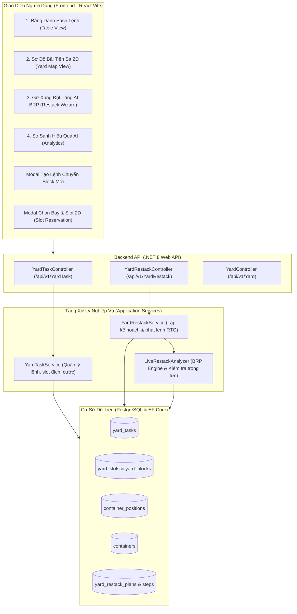

# TÀI LIỆU KỸ THUẬT & NGHIỆP VỤ HỆ THỐNG ĐIỀU HÀNH BÃI CONTAINER CẢNG TIÊN SA
**Dự án:** NexusPort — Smart Port Management System  
**Phân hệ:** Quản Lý Tác Nghiệp Bãi (Yard Management System - TOS Smart Yard)  
**Mã tính năng:** NXP-119 (Lệnh Di Chuyển Bãi) & NXP-126 (Tối Ưu & Gỡ Xung Đột Tầng BRP)  
**Ngày cập nhật:** 20/11/2026  

---

## 1. TỔNG QUAN HỆ THỐNG

Phân hệ Điều hành Bãi Container Cảng Tiên Sa phụ trách điều phối toàn bộ các hoạt động luân chuyển container trong bãi, bao gồm:
1. **Lệnh Di Chuyển Container Giữa Các Block (Relocation & Inter-Block Shifting - NXP-119):** Cho phép điều độ viên tạo lệnh, chọn container thực tế trong bãi, đối soát slot đích thông qua Sơ đồ 2D trực quan bãi Tiên Sa, và theo dõi tiến trình cẩu thực thi qua 4 bước chuẩn TOS.
2. **Thuật Toán Tối Ưu & Gỡ Xung Đột Tầng (De-conflict / Restack Optimization - NXP-126):** Tự động phát hiện các container bị chôn dưới đáy cột xếp khi chuẩn bị xuất tàu hoặc giao nhận cho xe đầu kéo, tính toán chuỗi lệnh đảo cẩu tối ưu (giảm thiểu số lần dời, rút ngắn quãng đường cẩu RTG), và triển khai tự động xuống hệ thống cẩu.
3. **Đồng Bộ Sơ Đồ 2D Tiên Sa (Digital Twin 2D):** Toàn bộ phân khu A, B, C, D, E, F, G và các Block bãi được số hóa trực quan, cho phép định vị chuẩn xác `Block-Bay-Row-Tier`.

---

## 2. CHI TIẾT CÁC TÍNH NĂNG ĐÃ TRIỂN KHAI

### 2.1. Lệnh Di Chuyển Container Giữa Các Block (NXP-119)
- **Tập trung vào dữ liệu thật:** Loại bỏ toàn bộ các lệnh mẫu cũ (`MOV-1025`, `MOV-1024`, `MOV-1022`, `MOV-1020`), kết nối trực tiếp với bảng `yard_tasks` và `container_positions`.
- **Tích hợp đồng bộ giao diện Dispatcher:** Modal tạo lệnh áp dụng quy trình 2 bước chuẩn:
  - **Bước 1:** Chọn phân khu bãi cảng Tiên Sa (Zone A đến G).
  - **Bước 2:** Chọn Block đích với thông tin trực quan về sức chứa (Total Capacity) và số slot trống còn lại.
  - **Mở Sơ Đồ Slot 2D:** Sử dụng component [YardSlotReservationModal.jsx](../../NexusPort_FRONTEND_Website/src/components/Yard/YardSlotReservationModal.jsx) cho phép click trực tiếp chọn Bay, Hàng (Row), Tầng (Tier).
- **Luồng 4 Bước Tác Nghiệp RTG Thực Tế:**
  1. `PENDING` (Chờ điều phối)
  2. `IN PROGRESS` (Đang cẩu - RTG nâng container, đồng hồ đo thời gian thực hoạt động)
  3. `AT DESTINATION` (Đã đưa sang Block đích)
  4. `COMPLETED` (Xác nhận hạ bãi, cập nhật tọa độ mới vào CSDL)

### 2.2. Gỡ Xung Đột Tầng & Tối Ưu Hóa BRP (NXP-126)
- **Phát hiện container bị đè tầng:** Quét cột xếp hiện tại để nhận diện các container đè phía trên ($N$ container tại các Tier cao hơn).
- **Thuật toán tìm Slot đệm (Buffer Slot Allocation):**
  - Kiểm tra điều kiện cứng: Slot trống, không bảo trì, cùng loại kích thước, thỏa mãn tầng đỡ bên dưới.
  - Chấm điểm tối ưu: Ưu tiên slot gần nhất trong cùng Block (rút ngắn quãng đường di chuyển của cẩu), tránh các vị trí có lịch hẹn xuất sớm.
- **Tùy chọn Hoàn Về Vị Trí Cũ (`RestackBackToOriginal`):** Cung cấp cấu hình cho phép đưa container đè trở lại cột ban đầu hoặc giữ nguyên tại slot đệm mới.
- **Triển khai 1-Chạm:** Tự động phát sinh chuỗi $N + 1$ lệnh cẩu tuần tự và truyền trực tiếp xuống thiết bị RTG.

---

## 3. CÁC QUY TẮC AN TOÀN VẬT LÝ & KIỂM TRA TRỌNG LỰC (ISO 1496/1 & TOS 4.5.1)

Hệ thống cài đặt bộ quy tắc xác thực nghiêm ngặt tại cả Frontend ([YardSlotReservationModal.jsx](../../NexusPort_FRONTEND_Website/src/components/Yard/YardSlotReservationModal.jsx)) và Backend ([LiveRestackAnalyzer.cs](../csharp-core/src/Modules/Yard/Application/Services/LiveRestackAnalyzer.cs)):

| STT | Quy Tắc Kiểm Tra | Xử Lý Khi Vi Phạm | Căn Cứ Tiêu Chuẩn |
|---|---|---|---|
| 1 | **Quy tắc Trọng Lực Nền (Grounding Rule)** | Không được đặt container tại Tier $K$ ($K > 1$) nếu Tier $K-1$ bên dưới còn trống. | TOS Safe Stacking 4.5.1 |
| 2 | **Cấm 40ft trên 1x 20ft** | Container 40ft chiếm 2 Bay liền kề. Cấm tuyệt đối xếp 40ft đè lên chỉ 1 container 20ft bên dưới vì thiếu điểm tựa gù góc (Corner Casting). Bắt buộc phải có đủ 2 container 20ft ở cả 2 Bay đỡ bên dưới. | ISO 1496/1 & IMO CSC |
| 3 | **Cấm 20ft trên 40ft** | Cấm xếp container 20ft đè lên trên container 40ft tại các tầng trên vì điểm tỳ góc giữa của 20ft không chịu được lực trên nắp cont 40ft. | ISO 1496/1 |
| 4 | **Quy ước Bay Chẵn / Lẻ Bãi Tiên Sa** | Container 20ft xếp tại Bay lẻ (Bay 01, 03, 05...). Container 40ft chiếm 2 ô liền kề và mang mã Bay chẵn định danh (Bay 02, 04, 06...). | Chuẩn TOS Tiên Sa |
| 5 | **Bảo lưu Trạng thái Hàng (Cargo Hold/Hazard)** | Container bị giữ hải quan (Customs Hold) hoặc hư hỏng nặng (Damaged/Unsafe) bị khóa, không được phép lập lệnh cẩu xuất trực tiếp. | An toàn cảng biển |

---

## 4. BẢNG TỔNG HỢP CÁC FILE & THÀNH PHẦN ĐÃ LÀM VIỆC

### 4.1. Phía Frontend (React + Vite + Tailwind CSS)

| File | Đường Dẫn | Vai Trò & Các Thay Đổi Chính |
|---|---|---|
| `YardMovementOperations.jsx` | `NexusPort_FRONTEND_Website/src/pages/Yard/YardMovementOperations.jsx` | Màn hình trung tâm quản lý di chuyển bãi: tích hợp bảng danh sách lệnh thật, Modal tạo lệnh 2 bước chuẩn Dispatcher, Wizard gỡ xung đột tầng với 1-chạm AI BRP, nhúng sơ đồ 2D và xử lý fallback an toàn khi mất kết nối. |
| `YardSlotReservationModal.jsx` | `NexusPort_FRONTEND_Website/src/components/Yard/YardSlotReservationModal.jsx` | Modal chọn vị trí bãi 2D: hiển thị mặt cắt Bay/Row/Tier, hỗ trợ chuyển đổi kích thước 20ft/40ft, kiểm tra chống rơi tự do và tương thích kích thước theo ISO 1496/1. |
| `YardDesignPreview.jsx` | `NexusPort_FRONTEND_Website/src/pages/Yard/YardDesignPreview.jsx` | Component nhúng sơ đồ tổng thể phân khu bãi Cảng Tiên Sa: tô màu trực quan vị trí gốc (Xanh dương) ➔ vị trí đích (Xanh lá). |
| `TienSaMap.jsx` | `NexusPort_FRONTEND_Website/src/features/yard-design/TienSaMap.jsx` | Bản đồ phân khu vector 2D thể hiện chi tiết layout các Zone A, B, C, D, E, F, G và cầu tàu Tiên Sa. |
| `BlockDetail.jsx` | `NexusPort_FRONTEND_Website/src/features/yard-design/BlockDetail.jsx` | Xem chi tiết cấu trúc ma trận slot bên trong từng Block bãi. |
| `LiveRestackPanel.jsx` | `NexusPort_FRONTEND_Website/src/pages/Yard/LiveRestackPanel.jsx` | Panel theo dõi các cảnh báo kẹt tầng container có lịch hẹn lấy trong 24 giờ tới. |
| `yardTaskService.js` | `NexusPort_FRONTEND_Website/src/services/yardTaskService.js` | Service API gọi backend: `getRelocationTasks`, `getActiveContainers`, `validateTargetSlot`, `calculateShiftingFee`, `startLift`, `completeLift`. |
| `yardRestackService.js` | `NexusPort_FRONTEND_Website/src/services/yardRestackService.js` | Service API gọi backend: `analyzeBlockedContainer`, `createPlan`, `deployPlan`, `completeStep`, `cancelPlan`. |

### 4.2. Phía Backend (.NET 8 + EF Core + Clean Architecture)

| File | Đường Dẫn | Vai Trò & Các Thay Đổi Chính |
|---|---|---|
| `YardTaskController.cs` | `Modules/Yard/Presentation/Controllers/YardTaskController.cs` | Controller cung cấp API: `/api/v1/YardTask/relocate-tasks`, `/api/v1/YardTask/active-containers`, `/api/v1/YardTask/validate-slot`, `/api/v1/YardTask/relocate`. |
| `YardRestackController.cs` | `Modules/Yard/Presentation/Controllers/YardRestackController.cs` | Controller cung cấp API BRP: `/api/v1/YardRestack/analyze`, `/api/v1/YardRestack/plan`, `/api/v1/YardRestack/{id}/deploy`, `/api/v1/YardRestack/{id}/steps/{step}/complete`. |
| `LiveRestackAnalyzer.cs` | `Modules/Yard/Application/Services/LiveRestackAnalyzer.cs` | Trọng tâm thuật toán BRP: quét vị trí thực, tự động gán slot nếu container chưa có vị trí bãi được xác nhận, tính toán số bước đảo, chấm điểm slot đệm an toàn và sinh chuỗi lệnh cẩu. |
| `YardRestackService.cs` | `Modules/Yard/Application/Services/YardRestackService.cs` | Quản lý vòng đời kế hoạch đảo bãi: tạo draft plan, deploy plan xuống cẩu, xác nhận hoàn thành từng bước và cập nhật vị trí container. |
| `YardTaskService.cs` | `Modules/Yard/Application/Services/YardTaskService.cs` | Quản lý tác nghiệp di chuyển: truy vấn active containers, tạo lệnh di chuyển giữa các block, kiểm tra tính hợp lệ của slot đích theo quy tắc bãi. |
| `YardContainerSnapshot.cs` | `Modules/Yard/Application/Services/YardContainerSnapshot.cs` | Đọc nhanh snapshot trạng thái container: Full/Empty, trọng lượng Gross, trạng thái khóa hải quan. |
| `YardSlot.cs` | `Modules/Yard/Domain/Entities/YardSlot.cs` | Thực thể slot bãi: Bay, Row, Tier, trạng thái slot (`empty`, `occupied`, `reserved`), cắm điện lạnh (`HasReeferPlug`). |
| `YardTaskDtos.cs` & `YardRestackDtos.cs` | `Modules/Yard/Application/DTOs/` | Tập hợp các DTO truyền nhận dữ liệu chuẩn giữa Client và Server. |

---

## 5. DANH MỤC API ENDPOINTS CHÍNH

### 5.1. Phân Hệ Tác Nghiệp Bãi (Yard Task)
- `GET /api/v1/YardTask/relocate-tasks`: Lấy danh sách các lệnh di chuyển bãi đang chờ hoặc đang thực thi.
- `GET /api/v1/YardTask/active-containers`: Lấy danh sách toàn bộ container đang thực tế có mặt trong bãi cảng.
- `POST /api/v1/YardTask/relocate`: Tạo một lệnh chuyển container giữa 2 Block mới.
- `POST /api/v1/YardTask/validate-slot`: Kiểm tra slot đích có hợp lệ, trống và thỏa mãn trọng lực hay không.
- `POST /api/v1/YardTask/{id}/start-lift`: Bắt đầu cẩu container (`In_Progress`).
- `POST /api/v1/YardTask/{id}/complete-lift`: Hoàn thành cẩu và ghi nhận vị trí hạ bãi mới.

### 5.2. Phân Hệ Gỡ Xung Đột Tầng (Yard Restack BRP)
- `POST /api/v1/YardRestack/analyze`: Phân tích container chỉ định, tìm các container đè phía trên và đề xuất slot đệm an toàn.
- `POST /api/v1/YardRestack/plan`: Lưu kế hoạch gỡ xung đột (Draft).
- `POST /api/v1/YardRestack/{id}/deploy`: Triển khai chuỗi lệnh cẩu xuống hệ thống cẩu RTG.
- `POST /api/v1/YardRestack/{id}/steps/{stepNumber}/complete`: Xác nhận hoàn thành một bước cẩu trong kế hoạch.

---

## 6. NHẬT KÝ SỰ CỐ KỸ THUẬT & CÁCH ĐÃ XỬ LÝ (TROUBLESHOOTING LOG)

1. **Sự cố reset vị trí sau 1s trong modal:**
   - *Nguyên nhân:* State component re-render làm mất giá trị selection tạm thời.
   - *Khắc phục:* Áp dụng `useRef` guard và cố định `modalBooking` bằng `useMemo`.
2. **Lỗi `ReferenceError: Cannot access 'newContainerType' before initialization`:**
   - *Nguyên nhân:* Thứ tự khai báo biến bị đảo lộn trong file component lớn.
   - *Khắc phục:* Định vị lại thứ tự khai báo hàm chuẩn mực trước khi component render.
3. **Lệch kích thước dropdown (20ft hiển thị thành 40ft):**
   - *Nguyên nhân:* Giá trị API trả về (`20FT RF`) không khớp với danh sách `<option>` của HTML select dẫn đến fallback về option đầu tiên.
   - *Khắc phục:* Thêm hàm chuẩn hóa `normalizeDropdownType`, bổ sung toàn bộ các biến thể 20ft/40ft và hiển thị badge động `⚡ 20 FEET` / `🚢 40 FEET`.
4. **Lỗi 422: `Container HAMU9350046 chưa có vị trí bãi được xác nhận`:**
   - *Nguyên nhân:* Container tồn tại trong bảng tác nghiệp nhưng chưa có bản ghi hiện hành trong `container_positions`.
   - *Khắc phục:* Bổ sung cơ chế auto-locate trong [LiveRestackAnalyzer.cs](../csharp-core/src/Modules/Yard/Application/Services/LiveRestackAnalyzer.cs) tự động ánh xạ và ghi nhận vị trí bãi từ tọa độ `request.Location`.
5. **Lỗi `ReferenceError: scenario is not defined`:**
   - *Nguyên nhân:* Khối fallback trong `handle1ClickOptimizeConflict` tham chiếu đến biến `scenario` chưa được khai báo.
   - *Khắc phục:* Khai báo `const scenario = currentConflictScenario;` và đồng bộ chính xác dữ liệu container mục tiêu.
